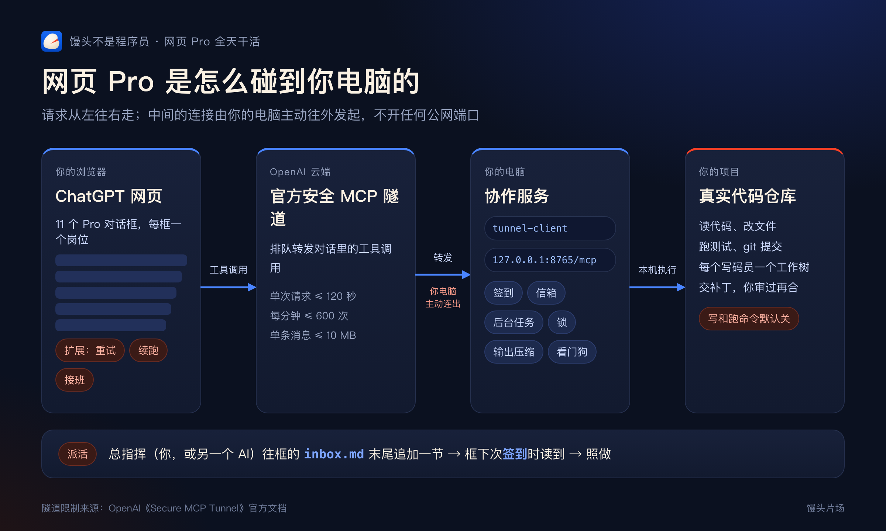

# pro-lane-kit

让网页版 ChatGPT Pro 在你自己的电脑上长时间干活的最小工具包：一个默认只读的本机协作服务、一套让它不停下来的开场话和信箱做法，外加一个默认关闭的续跑扩展。

> **先读 [SECURITY.md](SECURITY.md)。** 让网页 AI 碰你的电脑有真实风险。本工具包默认只读，写文件和跑命令要你自己打开。

## 它怎么工作



```
网页 ChatGPT（Pro 对话框）
   │  调用工具
OpenAI 官方安全 MCP 隧道
   │  由你电脑上的 tunnel-client 主动连出，不开公网端口
本机协作服务 127.0.0.1:8765/mcp（本工具包）
   │
你的项目：读文件 · 写文件（默认关）· 跑命令（默认关）· 后台任务（默认关）
```

让它一直干，靠四件小事：

1. **活写在文件里**：你往 `lanes/<车道名>/inbox.md` 末尾追加一节，不用进对话框打字。
2. **做完一件就签到**：`lane_checkin` 返回信箱最新一节和清单接下来 3 件。
3. **长命令丢后台**：前台命令 45 秒封顶，超过 30 秒的用 `start_command` 和 `get_command`。
4. **停了有人接**：对话坏了，新对话贴[通用续干](prompts/通用续干.md)，读签到记录接着干；可选的续跑扩展会在停 90 秒时发一句“继续”。

## 安装

需要：一台常开的电脑（macOS、Linux 已写好示例；Windows 的后台任务停止逻辑未测试）、Python 3.10 以上、ChatGPT Pro 账号、OpenAI 开发者平台账号（建隧道用）。

```bash
cd server
python3 -m venv .venv && source .venv/bin/activate
pip install -r requirements.txt
cp config.example.json config.json   # 把 roots 改成你的项目目录，先别动两个 allow 开关
python pro_lane_server.py
```

服务只监听 `127.0.0.1:8765`。然后照 [ops/tunnel-client.md](ops/tunnel-client.md) 接隧道、在 ChatGPT 里加插件。

开工：新建聊天 → 模型选 Pro → @ 你的插件 → 贴[开场话模板](prompts/开场话模板.md)。信箱和清单的写法见[这里](prompts/信箱格式.md)，`lanes/example/` 是一个现成例子，车道名就用 `example` 试。

## 工具

| 工具 | 干什么 | 默认 |
|---|---|---|
| `lane_checkin` | 签到领活；`first=true` 时带上上一班最后 10 行签到 | 开 |
| `read_file` / `read_bundle` / `list_dir` | 读文件、一次读一批、列目录 | 开 |
| `write_file` | 原子写入，可带 sha256 防覆盖 | **关**（`allow_write`） |
| `run_command` | 前台短命令，45 秒封顶 | **关**（`allow_shell`） |
| `start_command` / `get_command` | 后台任务，一次最多等 25 秒 | **关**（`allow_shell`） |

开关关着的时候，这几个工具不会注册，ChatGPT 看不到。改开关要重启服务，并到插件设置里刷新工具清单（ChatGPT 会记着旧清单）。

## 配置 `server/config.json`

| 字段 | 说明 | 默认 |
|---|---|---|
| `roots` | 允许访问的目录，必填。相对路径从第一个算 | 无 |
| `allow_write` / `allow_shell` | 写文件 / 跑命令 | `false` |
| `port` | 本机端口 | `8765` |
| `lanes_dir` | 车道文件夹 | 示例配置是 `../lanes` |
| `shell_timeout` | 前台命令秒数上限 | `45` |
| `job_timeout` / `max_jobs` | 后台任务时限（秒）/ 同时几个 | `3600` / `4` |
| `deny_globs` | 拒读拒写的文件名规则 | 见 `lane_core.py` |

注意：`allow_shell` 打开后，命令以你的用户身份运行。`roots` 和 `deny_globs` 只管文件工具，**管不住 shell 命令**，详见 SECURITY.md。

## 续跑扩展（可选，默认关）

`extension/` 里有两个脚本：自动继续、自动重试。两个都默认关闭。

**可能违反 ChatGPT / OpenAI 使用条款，可能导致账号受限，风险自负。**

要用：Chrome 打开 `chrome://extensions` → 打开开发者模式 → 加载已解压的扩展程序 → 选 `extension` 文件夹；再把脚本里 `const ENABLED = false` 改成 `true`，回到扩展页点“重新加载”，刷新 ChatGPT 页面。

额度：每框每小时 4 次、每框每天 20 次、所有框每天合计 150 次。在对话里发一句【暂停】，它就不再碰这个框。ChatGPT 改版后页面元素可能变，到时候脚本需要跟着改。

## 常见问题

- **工具调用超时、回复丢了**：命令太久。放后台，别在前台等。
- **对话越用越卡**：开新对话贴通用续干。平时少回传大段内容，不截图。
- **框老是停**：检查开场话第一句是不是签到；有没有写“做完就停”或“结尾写下一步”；清单是不是空了。
- **加了新工具对话里看不到**：去插件设置刷新。
- **看不到写入工具**：确认 `allow_write` 是 `true`、服务已重启、插件已刷新，并检查开发者模式和权限档。

## 自测

```bash
cd server && python3 -m unittest test_lane_core.py
```

## 官方功能

本工具包用到的安全 MCP 隧道、自定义 MCP 插件是 OpenAI 官方功能。官方还有 Goal 模式（桌面版 `/goal`）、ChatGPT Work、定时任务，能满足需求的话优先用官方的。

## 协议

MIT。与 OpenAI 无关联。按“现状”提供，不作任何担保。
